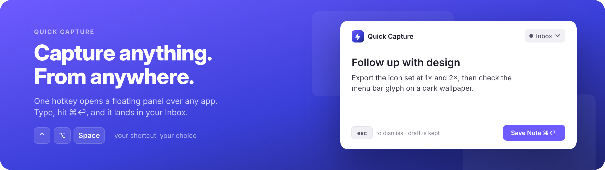

<p align="center">
  <picture>
    <source media="(prefers-color-scheme: dark)" srcset=".github/assets/noteit-banner-hero-dark.svg">
    
  </picture>
</p>

A native macOS notes app with Apple Notes speed, power-user formatting, capture from anywhere, and optional end-to-end encrypted sync through storage you own.

[](LICENSE)
[](https://github.com/rutbergphilip/noteit/actions/workflows/ci.yml)


NoteIt is a SwiftUI and AppKit app. Its only third-party dependency is [Sparkle](https://sparkle-project.org), for updates. Your notes are files on your Mac. There's no account and no NoteIt server. If you want your Macs in sync, point NoteIt at a folder or an S3-compatible bucket you control, such as a MinIO instance on your NAS, and it encrypts everything before it leaves the machine.

> NoteIt was formerly called Inkwell. Existing notes, settings and sync setup migrate automatically the first time NoteIt launches; if Inkwell is still open, NoteIt asks to quit it first. Afterwards `~/Library/Application Support/Inkwell` is a link to the NoteIt folder, so an old copy of Inkwell opens the same notes, and NoteIt asks you to quit Inkwell if both are open.

> **Status:** working app, single user, macOS 14 Sonoma or later. See [Known limitations](docs/known-limitations.md) for what's missing, and the [changelog](CHANGELOG.md) for what changed in each release.

## Features



- **Capture from anywhere**
  - Global hotkeys for *Show / Hide NoteIt*, *New Note*, *Quick Capture*, *Open Quickly*, *Command Palette* and *Capture Selection*. They're unbound by default, you record your own, and the hotkeys themselves need no Accessibility permission.
  - **Capture from any app.** Select text anywhere and press *Capture Selection*, or use *Services › Capture to NoteIt*, to save it as a note with a link back to the page or document it came from. Reading the selection with the hotkey is opt-in and needs Accessibility permission.
  - A Spotlight-style **Quick Capture** panel that floats over any app, including full-screen ones, and keeps your draft when dismissed. A waiting draft shows as a dot on the menu bar icon.
  - A **menu bar panel** with search, a quick-note composer, and Pinned and Recent notes. It's fully keyboard-driven.
  - A *Menu bar only* mode and *Launch at login*.
- **Organize your way**
  - Notebooks with a color and an SF Symbol icon, nested up to four levels. Drag to reorder or nest them, and drop notes onto them to move them.
  - Automatic `#hashtag` tags that nest with `/` (`#work/clients`), shown as chips and completed as you type. Rename, merge or delete a tag across every note.
  - **Smart folders** save a search, such as `tag:work is:todo edited:<7d`, and stay up to date. Pinned and Recent (last 7 days) are there too.
  - Search ranked by best match, with the matches highlighted in the list and the note. It ignores case and accents and understands filters such as `tag:`, `notebook:`, `is:todo` and `due:`.
  - **Tasks** (⇧⌘T) lists every checkbox across your notes, grouped by due date. Type `@due(tomorrow)` or press ⇧⌘D to set one.
  - **Reminders** (⌃⌘R) ring at the time written in the line, with Done, Snooze and Tomorrow, and show on one Mac only.
  - A **command palette** (⌘O) to open notes and notebooks or run commands by typing a few letters.
- **Link your notes**
  - Type `[[` to link to another note or one of its headings. Clicking a link to a note that doesn't exist yet creates it.
  - **Links and Outline** (⌥⌘I) shows the notes that link here, the links in this note, unlinked mentions of its title and its headings. Go Back and Go Forward (⌃⌘← / ⌃⌘→) retrace the notes you opened.
  - **Note info** (⌃⌘I) opens the same panel on its Info tab, with word count, characters, reading time, created and last edited dates, notebook and tags.
  - Renaming a note offers to update the text of links to it.
  - **Daily notes.** ⌃⌘T opens today's note, Today in the sidebar does the same, and a calendar opens any day. There's an optional global hotkey too.
  - **Templates.** Notes in the Templates notebook can start new notes, with placeholders for the date, time, title and clipboard. A notebook can have a default template.
  - Wiki links survive Markdown export and come back when you import a folder of Markdown files.
- **Format richly**
  - Title, heading and subheading styles, bold, italic, underline, strikethrough and inline code.
  - Bulleted, numbered and checklist lists, tables, code blocks, quotes, dividers, links and images.
  - Text colors and highlights.
  - Markdown as you type: `#`, `-`, `1.`, `[ ]`, `>`, ```` ``` ````, `---`, `**bold**`, `*italic*`, `` `code` `` and `~~strike~~`.
  - Paste Markdown and it comes in formatted. ⇧⌘V pastes just the text.
  - About 30 keyboard shortcuts. See the [shortcut reference](docs/keyboard-shortcuts.md).
  - Menu shortcuts such as New Note, Find… and Print… can be changed in Settings › Shortcuts.
- **Native and local-first**
  - A short **first-run guide** (Help › Welcome to NoteIt…) helps set up hotkeys, the menu bar, imports and sync.
  - Light and dark mode, system accent color, and standard menus and Settings.
  - Notes are stored as RTFD in `~/Library/Application Support/NoteIt/`, with autosave and atomic writes.
- **Optional sync** between Macs through storage you own, end-to-end encrypted by default. See below.

## Sync & encryption

Sync is off until you connect it in **Settings › Sync**. Until then NoteIt makes no sync requests and runs no sync timers. The only other network traffic is the update check, which you can turn off in **Settings › General**.

| Provider | Notes |
|---|---|
| Folder | Any folder: a NAS share, iCloud Drive, Dropbox or a USB drive |
| Amazon S3 | Your own AWS bucket |
| Cloudflare R2 | S3-compatible, no egress fees |
| Backblaze B2 | S3-compatible |
| Google Cloud | Cloud Storage through its S3-compatible API with HMAC keys |
| MinIO / NAS | Self-hosted S3 on your network; `http://` is allowed for local servers |
| Custom S3 | Any other S3-compatible service, such as Wasabi or Synology C2 |

- **The storage is yours.** NoteIt doesn't run a server and never sees your data. On a second Mac, point it at the same location and enter the same passphrase.
- **End-to-end encryption is on by default.** Notes use AES-GCM with a key derived from your passphrase through PBKDF2-HMAC-SHA256. Only a small `manifest.json` that describes the format is stored unencrypted. The passphrase stays in the macOS Keychain and is never uploaded. **If you lose it, your synced notes can't be decrypted.**
- **Conflicts never lose data.** If a note changes on two Macs before they sync, the remote version is kept as a badged conflict copy and listed under a *Conflicts* filter.
- **It's lightweight.** It runs a single listing per check, once a minute while you use NoteIt and every 10 minutes in the background, on a low-priority thread.

**Self-hosted web app (preview).** [`web/`](web/README.md) holds a browser client and a small server for your homelab (one Docker image, one volume). The browser encrypts notes before upload, so the server only stores ciphertext; each person in a household gets an isolated store, and the Mac app can sync with the same server through its S3 backend (endpoint `https://<server>/s3`). It needs a library in the new `noteit-doc` note format. Releases publish a Docker image, `ghcr.io/rutbergphilip/noteit-web`; the [self-hosting guide](docs/self-hosting.md) covers setup, reverse proxies, backups and upgrades.

The full sync and encryption design is documented in [`docs/specs/2026-10-12-sync-design.md`](docs/specs/2026-10-12-sync-design.md). Its limitations are listed in [Known limitations](docs/known-limitations.md#sync). Folders synced by tools like Dropbox and S3 providers without conditional writes get best-effort race protection only.

## Install

Download the latest `NoteIt-<version>.dmg` from [Releases](https://github.com/rutbergphilip/noteit/releases/latest), open it and drag NoteIt to Applications. Or install it with [Homebrew](https://brew.sh):

```sh
brew install --cask rutbergphilip/tap/noteit
```

Release builds are signed and notarized, and need macOS 14 Sonoma or later. Updates arrive through **Check for Updates…** in the NoteIt menu, and NoteIt can check for them automatically.

## Build from source

**Requirements**

- macOS 14 Sonoma or later.
- Xcode 16 / Swift 6 toolchain (package uses Swift 5 language mode): Xcode 16 or later, or the matching Command Line Tools. The package manifest declares `swift-tools-version:5.10`.
- Running the unit tests needs Xcode, because the Command Line Tools don't ship XCTest.

```sh
git clone https://github.com/rutbergphilip/noteit.git
cd noteit
./scripts/build_app.sh      # release build → ~/Applications/NoteIt.app
open ~/Applications/NoteIt.app
```

`build_app.sh` builds in release mode, writes `Info.plist`, builds the app icon, ad-hoc signs the bundle and installs it atomically. You can set `NOTEIT_INSTALL_DIR`, `NOTEIT_VERSION` and `NOTEIT_BUILD` to override the install location and version numbers, `NOTEIT_SIGN_IDENTITY` to sign with a real identity, and `NOTEIT_UNIVERSAL=1` to build for both Apple silicon and Intel. See [docs/development.md](docs/development.md) for details.

For development:

```sh
swift build                 # debug build
swift run NoteIt            # run unbundled; launch at login is unavailable this way
NOTEIT_DATA_DIR=~/scratch/noteit swift run NoteIt   # use a scratch library instead of your real notes
```

Debug builds accept extra launch arguments and environment variables for screenshots and self-tests. They're listed in [docs/development.md](docs/development.md#debug-launch-arguments), and [docs/architecture.md](docs/architecture.md) explains how the app is put together.

## Testing

```sh
DEVELOPER_DIR=/Applications/Xcode.app/Contents/Developer swift test
```

- 200 XCTest cases in `Tests/NoteItSyncTests/` and `Tests/NoteItTests/` cover the sync planner, the engine against in-memory and faulty backends, the folder backend (including a cross-process lock test), S3 request handling, SigV4 signing, list parsing, crypto, the migration from Inkwell, and how the app picks, migrates and seeds its library at launch.
- `DEVELOPER_DIR` points SwiftPM at Xcode's toolchain without changing `xcode-select`.
- **Live S3 tests** (`LiveS3EmulatorTests`) are skipped by default. With Docker running, this starts [Floci](https://github.com/floci-io/floci) emulators, runs the suite against each one, and removes the containers:

  ```sh
  ./scripts/live_s3_tests.sh            # Amazon S3 and Google Cloud Storage emulators
  ./scripts/live_s3_tests.sh aws        # just one
  ```

  To test against another server, such as your own MinIO, set `NOTEIT_LIVE_S3_ENDPOINT` and optionally `NOTEIT_LIVE_S3_REGION`, `_BUCKET`, `_ACCESS_KEY`, `_SECRET` and `_CREATE_BUCKET=1`.
- The app layer is checked with debug-only self-test modes such as `NOTEIT_SYNC_SELFTEST=1` and `NOTEIT_EDITOR_SELFTEST=1`. Always pair them with `NOTEIT_DATA_DIR`.
- CI runs `swift build`, `swift test` and a release build on macOS. Releases are built, signed and published by a separate workflow; see [docs/releasing.md](docs/releasing.md). The live emulator tests don't run in CI, because the macOS runners have no Docker.

## Roadmap

See [docs/roadmap.md](docs/roadmap.md) for what's planned and in which order. Contributions and design discussion are welcome.

## Project layout

```text
Package.swift                 Swift package: NoteIt (app), NoteItSync (library), NoteItSyncTests
Sources/NoteIt/               the macOS app (SwiftUI + AppKit)
├── App/                      app entry, AppDelegate, window routing
├── Model/                    NoteStore, notebooks and notes, seed content
├── Views/                    main window: sidebar, note list, editor container
├── Editor/                   rich-text editor, markdown shortcuts, formatting toolbar
├── MenuBar/                  menu bar panel, Quick Capture
├── Hotkeys/                  Carbon global hotkeys, shortcut recorder
├── Settings/                 Settings tabs and preferences
├── Linking/                  link index, backlinks, link suggestions, outline, templates
├── Reminders/                reminder scheduling, notifications, one-Mac claims
├── Automation/               Local API, URL scheme, Shortcuts, Spotlight
└── Sync/                     SyncController, NoteStore adapter, provider config, Keychain
Sources/NoteItSync/           sync engine with no AppKit dependency
├── Storage/                  folder and S3 backends, SigV4
├── Crypto/                   PBKDF2 key derivation, AES-GCM
├── Engine/                   SyncPlanner (pure decision table), SyncEngine
├── Model/                    manifest, sync state, records
└── Migration/                app identity, env vars, Inkwell → NoteIt migration
Tests/NoteItSyncTests/        XCTest suite (+ opt-in live S3 tests)
scripts/                      build_app.sh, release scripts, live_s3_tests.sh, make_icon.swift, render_icon.sh
design/                       logo and icon assets, brand guidelines
docs/                         architecture, development, releasing, keyboard shortcuts, known limitations
docs/specs/, docs/plans/      design specs and implementation plans
CHANGELOG.md                  user-facing changes per release
```

## Contributing

Contributions are welcome. Read [CONTRIBUTING.md](CONTRIBUTING.md) for dev setup, code style and the DCO sign-off (`git commit -s`), and follow the [Code of Conduct](CODE_OF_CONDUCT.md).

## Security

Please don't open public issues for vulnerabilities. Report them through GitHub private vulnerability reporting. [SECURITY.md](SECURITY.md) covers the scope and the threat model.

## License

NoteIt is free software, licensed under the [GNU Affero General Public License v3.0 or later](LICENSE) (AGPL-3.0-or-later). If you distribute NoteIt, or a modified version of it, or run a modified version as a network service, you must make the corresponding source available under the same license.

Copyright © 2026 Philip Rutberg and contributors.

SPDX-License-Identifier: AGPL-3.0-or-later

## Design

[`design/`](design/) has NoteIt's logo, icon assets and logo usage guidelines; see [`design/BRAND.md`](design/BRAND.md).

<p align="center"></p>
